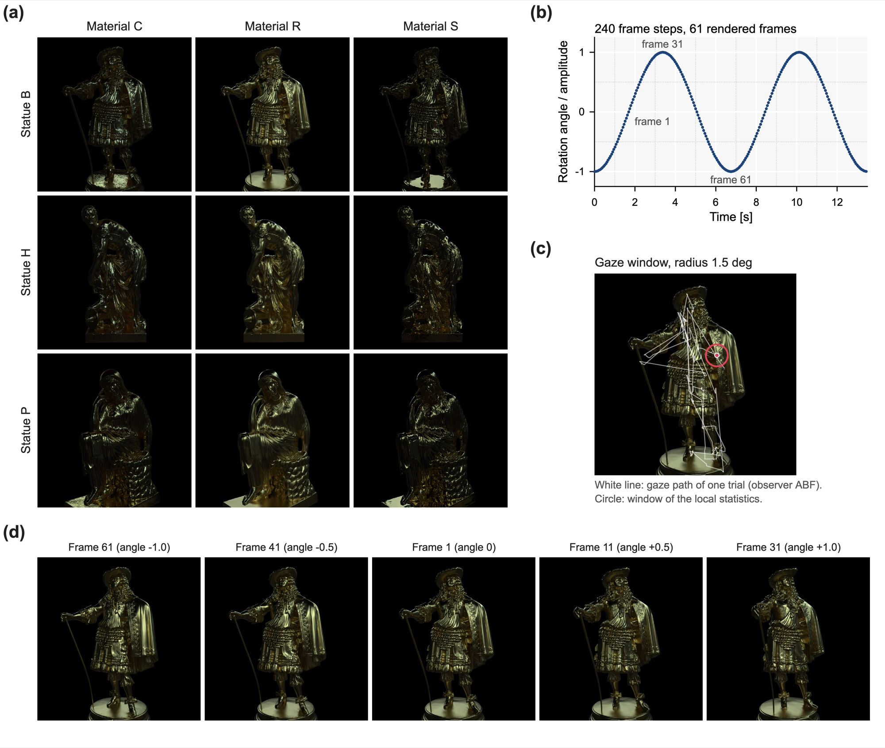
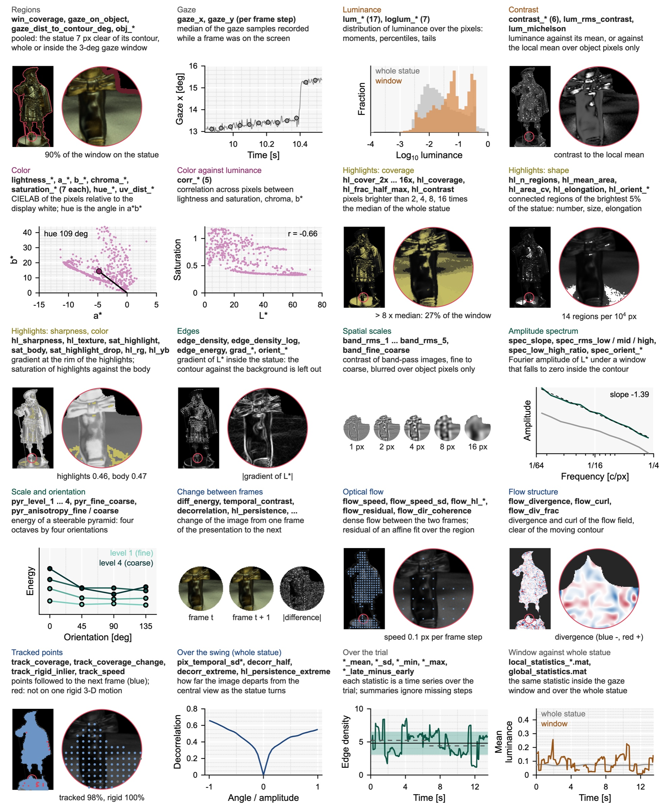

# material_statue_modelling

Image and video statistics of rendered statues, computed over the whole statue
and around the gaze position of an observer. All code is MATLAB.



*The stimuli. (a) The nine conditions: three statues in three materials. (b) The
statue swings sinusoidally about its central view for two cycles, from the left
to the right and back; the 240 frame steps of a trial are drawn from 61
rendered frames. (c) The gaze path of one trial and the window in which the
local statistics are computed. (d) Five views across the swing.*



*The statistics. Each panel shows one kind of statistic at one moment of one
trial: the whole statue with the gaze window (circle) on the left, the window
enlarged on the right. The names in bold are the names in the result files.
[docs/statistics.md](docs/statistics.md) lists all 161 statistics with their
definitions.*

## Contents

1. [What the repository does](#1-what-the-repository-does)
2. [Requirements](#2-requirements)
3. [Quick start](#3-quick-start)
4. [Step by step](#4-step-by-step)
5. [The eye-movement file](#5-the-eye-movement-file)
6. [Reading the results](#6-reading-the-results)
7. [The check video](#7-the-check-video)
8. [Settings to check](#8-settings-to-check)
9. [The statistics](#9-the-statistics)
10. [Running time, memory and common problems](#10-running-time-memory-and-common-problems)
11. [Files](#11-files)

## 1. What the repository does

In the experiment, observers viewed a rendered statue in one of nine conditions
(three statues: B, H, P; three materials: C, R, S). The statue swung
sinusoidally about its central view for two cycles in about 13.5 s (to the
right, then back to the left) while the observers answered questions about it,
and their eye movements were recorded with an EyeLink.

The repository computes a broad set of statistics of those stimuli (luminance,
color, contrast, highlights, spatial structure, motion) in two ways:

* **global**: over the whole statue, for every frame of every condition. No
  gaze data are needed.
* **local**: inside a circular window centred on the gaze position, for every
  moment of a recorded eye movement. The radius of the window is an argument,
  in degrees of visual angle.

Both use the same code: a local value is the global statistic restricted to the
pixels of the window, so the two are directly comparable. Only pixels of the
statue enter a statistic; the black background and the contour of the statue
are left out (section 9).

| Script | Input | Output |
| --- | --- | --- |
| `compute_global_statistics` | the nine stimulus files | `results/global_statistics.mat` (all conditions and frames in one file) |
| `compute_local_statistics(file, radius_deg)` | one eye-movement file, radius of the window | `results/local_statistics_<name>_r<radius>deg.mat` (one file per recording) |
| `make_trajectory_video(result_file)` | a local result file | a video of the trial with every statistic, for checking by eye (optional) |
| `demo` | the three example recordings | all of the above |

## 2. Requirements

* MATLAB (developed and tested with R2025b)
* Image Processing Toolbox, Computer Vision Toolbox, Statistics and Machine
  Learning Toolbox
* Parallel Computing Toolbox (optional; without it the loops run serially and
  take several times longer)
* The nine stimulus files (not part of the repository; see step 1)

## 3. Quick start

1. Put the nine stimulus files in `data/MAT-images/` (step 1 below).
2. In MATLAB, make the folder of the repository the current folder.
3. Run

```matlab
demo
```

This computes the statistics of the whole statue, then the statistics around
the gaze position for the three example recordings in `data/trajectories/`, and
makes a video of each (about 15 minutes the first time with a parallel pool).
The output appears in `results/`.

## 4. Step by step

### Step 1. Put the stimuli in place

The stimulus files are not part of this repository. Put **all nine .mat files**
in the folder `data/MAT-images/`:

```
data/MAT-images/BC.mat   BR.mat   BS.mat
                HC.mat   HR.mat   HS.mat
                PC.mat   PR.mat   PS.mat
```

The file name is the condition: statue (B, H, P) followed by material (C, R,
S). Each file holds one variable, `img`: a 1 x 61 cell array of 1024 x 1024 x 3
images (double, sRGB-encoded, between 0 and 1), one per rendered frame. The
scripts stop with a message that names the missing files if the folder is
incomplete.

### Step 2. Statistics of the whole statue

```matlab
compute_global_statistics
```

This computes every statistic for all nine conditions and all 61 frames and
writes one file, `results/global_statistics.mat` (about 6 minutes with a
parallel pool). Run it once; it does not depend on the gaze data.

### Step 3. Statistics around the gaze position

```matlab
compute_local_statistics(trajectory_file, radius_deg)
```

* `trajectory_file`: a csv file of eye movements (format in section 5)
* `radius_deg`: radius of the window around the gaze position, in degrees of
  visual angle (optional; default 1.5, a window 3 deg across: 111 of the 1024
  pixels of the image, which spans 27.6 deg)

For example, with one of the three recordings in `data/trajectories/`:

```matlab
compute_local_statistics('data/trajectories/ABF_1_BR_gaze_trajectory_coordinates.csv')        % radius 1.5 deg
compute_local_statistics('data/trajectories/ABF_1_BR_gaze_trajectory_coordinates.csv', 2.5)   % radius 2.5 deg
```

Each call writes one file, `results/local_statistics_<name>_r<radius>deg.mat`,
where `<name>` is the name of the trajectory file. One recording takes about a
minute with a parallel pool. Results for different radii are kept side by side,
since the radius is part of the file name.

To process your own recordings, put the csv files in `data/trajectories/` and
loop over them:

```matlab
files = dir('data/trajectories/*.csv');
for i = 1:numel(files)
    compute_local_statistics(fullfile(files(i).folder, files(i).name), 1.5);
end
```

### Step 4 (optional). A video to check a recording by eye

```matlab
compute_local_statistics('data/trajectories/ABF_1_BR_gaze_trajectory_coordinates.csv', 1.5, true)
```

With `true` as the third argument, a video of the trial is made as well
(`results/videos/<name>_r<radius>deg_trial<N>_<condition>.mp4`, about 2 minutes
per trial). A video can also be made afterwards from a result file:

```matlab
make_trajectory_video('results/local_statistics_ABF_1_BR_gaze_trajectory_coordinates_r1.5deg.mat')
```

Section 7 explains how to read the video.

## 5. The eye-movement file

One csv file per recording (one trial), with one row per gaze sample:

| Column | Content |
| --- | --- |
| `Timestamp_ms` | time stamp of the eye tracker [ms] (not used) |
| `Time_sec` | time from the start of the recording [s] |
| `Gaze_X`, `Gaze_Y` | gaze position in stimulus pixels: the frame of the stimulus as displayed, 1080 x 1080 pixels with the origin at its top-left corner, x rightward, y downward; `NaN` for missing samples (blinks) |
| `EventLabel` | event label of the sample (optional; passed on to the result as it is) |

The condition, the observer and the number of the trial are read from the
**file name**, whose parts are separated by underscores: the part that is a
condition (`BC`, `BR`, ..., `PS`), the first part (the observer) and the part
that is a number (the question asked), in any order. For example,
`ABF_1_BR_gaze_trajectory_coordinates.csv` is observer ABF, question 1,
condition BR (statue B, material R). A file whose name holds no condition is
refused.

Three recordings are in `data/trajectories/` as examples.

**Coordinates.** The positions are converted to pixels of the 1024-px stimulus
image by `utils/screen_to_image.m`, using the rectangle that the image occupies
in the coordinates of the file (`cfg.display.image_rect_px = [0 0 1080 1080]`).
For gaze in screen pixels, put the rectangle of the image on the screen there.

**Time.** The eye tracker samples faster than the frames change. The samples
recorded while a frame was on the screen are reduced to their median, which
gives one gaze position per frame step; a step with fewer than half of its
samples (blink, track loss) has no gaze position, and its statistics are NaN.
The 240 frame steps of a trial are spread evenly over the recording, from its
first to its last sample (`cfg.presentation.timing = 'recording'`; see
section 8).

A second layout is also read: a table of several trials already in image
pixels, with the columns `trial`, `observer`, `condition`, `task`, `time_s`,
`x_px`, `y_px` (described in `utils/load_trajectories.m`).

## 6. Reading the results

### The whole statue

`results/global_statistics.mat` holds one struct, `G`:

```matlab
load results/global_statistics.mat
G.conditions            % {'BC','BR','BS','HC','HR','HS','PC','PR','PS'}
G.frame.names           % 127 names: 122 image statistics + 5 of the silhouette
G.frame.values          % 9 x 61 x 127   [condition, rendered frame, statistic]
G.pair.names            % 20 names of the motion statistics
G.pair.values           % 9 x 60 x 20    [condition, pair of neighbouring frames, statistic]
G.clip.names            % 8 names of the statistics of the whole swing
G.clip.values           % 9 x 8          [condition, statistic]
G.summary.names         % 147 names: the frame and pair statistics
G.summary.mean          % 9 x 147: mean over the 240 frame steps of a trial (also .sd, .min, .max)
G.sequence              % the presentation: frame, angle and time of each of the 240 frame steps
G.catalog               % table: name, family, scope, label and definition of every statistic
G.cfg                   % the configuration used
```

The time course of one statistic over a trial:

```matlab
c = strcmp(G.conditions, 'BR');  k = strcmp(G.frame.names, 'hl_cover_8x');
plot(G.sequence.time, squeeze(G.frame.values(c, G.sequence.frame, k)));
xlabel('Time [s]'); ylabel('hl\_cover\_8x');
```

### Around the gaze position

`results/local_statistics_<name>_r<radius>deg.mat` holds one struct, `Lc`:

```matlab
load results/local_statistics_ABF_1_BR_gaze_trajectory_coordinates_r1.5deg.mat
Lc.trials               % table: trial, observer, condition, task
Lc.radius_deg           % radius of the window [deg]
Lc.names                % 148 names: 6 of the window + 122 image + 20 motion statistics
Lc.values               % trials x 240 x 148   [trial, frame step, statistic]
Lc.time                 % trials x 240 onset of each frame step in the recording [s]
Lc.frame, Lc.angle      % 1 x 240 the frame shown at each step and its rotation angle
Lc.gaze_x, Lc.gaze_y    % trials x 240 gaze position per frame step [image px]
Lc.event                % trials x 240 event label per frame step, as in the gaze file
Lc.summary.mean         % trials x 148: mean over the trial (also .sd, .min, .max, .late_minus_early, .n_valid)
Lc.catalog              % table: name, family, scope, label and definition of every statistic
Lc.source, Lc.cfg       % the trajectory file and the configuration used
```

The time course of one statistic in the gaze window:

```matlab
k = strcmp(Lc.names, 'edge_density');
plot(Lc.time(1, :), Lc.values(1, :, k));
xlabel('Time [s]'); ylabel('edge\_density');
```

The gaze window against the whole statue, for the same statistic and the same
frames:

```matlab
load results/global_statistics.mat
name  = 'lum_mean';
c     = strcmp(G.conditions, Lc.trials.condition(1));
local = Lc.values(1, :, strcmp(Lc.names, name));
whole = squeeze(G.frame.values(c, Lc.frame, strcmp(G.frame.names, name)));
plot(Lc.time(1, :), local, Lc.time(1, :), whole);
legend('gaze window', 'whole statue'); xlabel('Time [s]'); ylabel('lum\_mean');
```

The definition of a statistic, and the means over the trial as a csv table:

```matlab
Lc.catalog(strcmp(Lc.catalog.name, 'hl_sharpness'), :)

S = array2table(Lc.summary.mean, 'VariableNames', Lc.names);
writetable([Lc.trials, S], 'summary_mean.csv');
```

### Notes

* Steps without gaze, or with less than 10% of the window on the statue, are
  NaN and are ignored by the summaries (`Lc.summary.n_valid` counts the steps
  that have a value).
* The first six statistics of `Lc` describe the window itself: how much of it
  lies on the statue (`win_coverage`), whether gaze is on the statue
  (`gaze_on_object`), and where on the statue it is.
* A motion statistic at a frame step describes the change from that frame to
  the next one shown.
* `hue_mean` is an angle; average it with circular statistics.

## 7. The check video

The video shows a trial at half speed, for checking by eye that the gaze
position, the window and the statistics are what they should be.

* **Left, top**: the stimulus as it was shown, with the gaze window (circle)
  and the recent gaze path.
* **Left, bottom**: the gaze window enlarged, the time and the rotation angle
  of the statue. In the enlarged window, the pixels that do not enter the
  statistics are dimmed.
* **Right**: every statistic of the result file as a bar (148 bars in four
  columns, named as in `Lc.names` and colored by family).

How to read a bar:

* The **length of the bar** is the value of the statistic in the gaze window
  at that moment.
* The **axis of the bar** runs from the 5th percentile (left end) to the 95th
  percentile (right end) of that statistic over the recording. A long bar means
  a high value relative to the rest of the trial, not a high absolute value;
  the values themselves are in `Lc.values`.
* The **white tick** is the value of the whole statue in the same frame, on the
  same axis. A bar that ends to the right of its tick means that the region
  looked at has a higher value than the statue as a whole. The ticks are shown
  if `results/global_statistics.mat` exists; the six statistics of the window
  have none.

## 8. Settings to check

Every setting is in [`utils/analysis_config.m`](utils/analysis_config.m). Two
values describe the experiment. They are the current working assumptions and
are marked `CONFIRM` in that file; change them there if the experiment was
different, and run step 3 again.

| Setting | Current value | Used for |
| --- | --- | --- |
| `cfg.presentation.timing` | `'recording'`: the 240 frame steps are spread evenly over each recording (13.5 s, about 56 ms per step) | which frame was on the screen at each gaze sample |
| `cfg.presentation.start_frame` | 61: a trial starts at the extreme on the left, swings to the right and back | the same |

They only affect the local statistics.

**The visual angle.** The visual angle that the stimulus image spans is set in
[`display_config.json`](display_config.json), in the folder of the repository,
and nowhere else:

```json
{
  "image_size_deg": 27.6
}
```

In the experiment the image was 39.3 cm high (the full height of the display)
and was viewed from 80 cm, so it spanned 2 x atan(39.3 / (2 x 80)) = 27.6 deg.
With the 1024 pixels of the stimulus image, one degree is 37.1 image pixels,
and the default window of radius 1.5 deg is 55.7 pixels in radius. The value
sets the size of the gaze window and enters the statistics that are defined in
degrees: the six whose names end in `_deg` (size and position of the
silhouette, position of gaze) and the two contrast statistics that use a local
mean over 0.5 deg (`contrast_local_blur`, `contrast_meese_summers_blur`). After
changing it, run steps 2 and 3 again.

Pixels and degrees are converted linearly. `px_to_deg` and `deg_to_px` (in
`utils/`) do the conversion with the value of the file, for example to express
the speed of the optical flow in degrees per second:

```matlab
addpath utils
k = strcmp(Lc.names, 'flow_speed');                                   % pixels per frame step
speed = px_to_deg(Lc.values(1, :, k)) ./ median(diff(Lc.time(1, :)));   % degrees per second
```

**The presentation.** The 61 frames sample one sinusoidal swing at equal time
steps: frame 1 is the central view, frames 2-31 run from the centre to the
extreme on the right and frames 32-61 from the centre to the extreme on the
left. A trial starts at the extreme on the left (frame 61), swings to the right
and comes back: one cycle is 61, 60, ..., 32, 1, 2, ..., 31, 30, ..., 2, 1, 32,
..., 60 (120 frame steps), and a trial shows two cycles (240 frame steps).
[`utils/presentation_sequence.m`](utils/presentation_sequence.m) returns the
frame shown at every step. For a trial that starts at the central view, set
`start_frame = 1` (and `cfg.presentation.start_direction`, 1 for a first
movement to the right, -1 to the left).

With `timing = 'recording'` a recording is taken to span exactly the two
cycles; if the recordings include time before or after the motion, or the
frames were shown at a fixed rate, set `timing = 'nominal'` and
`cfg.presentation.trial_duration_s`.

Other settings that are likely to be changed are the default radius of the
window (`cfg.window.radius_deg`), the smallest part of the window that must lie
on the statue (`cfg.window.min_coverage`) and the width of the band left out at
the contour (`cfg.edge.border_px`).

## 9. The statistics

There are 161 statistics. [docs/statistics.md](docs/statistics.md) lists every
one with its definition; the same table is returned by `statistic_catalog()`
(in `utils/`) and stored in every result file (`G.catalog`, `Lc.catalog`).

| Family | Scope | N | Content |
| --- | --- | --- | --- |
| `luminance` | frame | 24 | distribution of luminance and log luminance: moments, percentiles, tails |
| `color` | frame | 41 | distribution of CIELAB L\*, a\*, b\*, chroma and saturation; hue; chromaticity |
| `color_luminance` | frame | 5 | correlations between lightness and color across pixels |
| `contrast` | frame | 6 | global contrast estimators (dynamic range, local contrast, Meese-Summers) |
| `highlight` | frame | 19 | coverage, number, size, shape, sharpness and color of the highlights |
| `spatial` | frame | 27 | edges, band-pass contrast, amplitude spectrum, steerable-pyramid energy, orientation |
| `temporal` | pair | 6 | change of the image between two successive frames |
| `flow` | pair | 10 | dense optical flow: speed, affine residual, divergence, curl |
| `tracking` | pair | 4 | optic-flow cues to shininess (Doerschner et al., 2011): tracked fraction, its change, rigidity |
| `geometry` | object | 5 | area, size and position of the silhouette |
| `geometry` | window | 6 | where the gaze window lies on the statue |
| `temporal` | clip | 8 | the whole swing: pixel variation, decorrelation from the central view |

**Scope.** *Frame* statistics (122) come from one frame and *pair* statistics
(20) from two frames that follow each other on the screen; both are pooled over
a region, either the whole statue or a gaze window. *Object* statistics (5)
describe the silhouette and *clip* statistics (8) the whole presented sequence
of a condition; they exist only globally. *Window* statistics (6) describe the
gaze window and exist only locally. The global file therefore holds 155
statistics (127 per frame, 20 per frame pair, 8 per condition) and a local file
148 (6 + 122 + 20).

**Units.** Luminance is linear with 1 = display white; L\*, a\*, b\* are
CIELAB relative to the display white. Lengths are in pixels of the 1024-px
image unless the name ends in `_deg`. Motion is in pixels per frame step of the
presentation; convert with `px_to_deg` and divide by the duration of a frame
step (the spacing of `Lc.time`, about 0.056 s) for degrees per second.

**Highlights** are defined relative to the whole statue in that frame (the
brightest 5% of its pixels; multiples of its median luminance), so that their
coverage is meaningful inside a window.

### Which pixels enter a statistic

The statue is rendered against a black background. Neither the background nor
the contour of the statue against it says anything about the material, so both
are kept out of every statistic:

* The silhouette is the union over the three materials of the lit pixels (the
  geometry is the same, and glossy materials have black pixels inside the
  object). A pixel is lit from one 8-bit step upward: the renderer's pixel
  filter leaves values near 1e-8 for about 2 px around the object, which a
  threshold of zero would count as object. Openings through which the
  background is seen stay background.
* Pixel statistics are pooled over the *interior*: the silhouette eroded by
  7 px (`cfg.edge.border_px`). A mean over a gaze window is therefore the mean
  over the pixels of the window that lie on the statue, not over the whole
  disk. The width of the band was measured on the stimuli: in material C the
  step of the contour is over within 2 px, but in materials R and S the rim of
  the object is black for a further 2 to 3 px, so the step from black to the
  lit surface lies deeper. There the gradient peaks 3 to 4 px inside the
  silhouette, at up to 7 times its interior level, and is back within 20% of it
  from the 8th pixel. One band is used for all materials, so the three
  materials of a statue are measured over exactly the same pixels.
* Blurred quantities (the local mean, the band-pass images) are normalized
  convolutions over the interior, so no background pixel enters a blurred value.
* Spectra and the steerable pyramid are computed on the image multiplied by a
  window that falls smoothly to zero inside the interior; the gaze window adds
  a raised-cosine taper at its rim.
* Optical flow and tracked points leave out a 15-px band at the contour, where
  the flow describes the outline moving over the background.
* A gaze window with less than 10% of its area on the statue gives NaN.

Values cannot diverge at dark pixels either: log luminance is floored at 1e-4
(`cfg.stats.lum_floor`), the denominators of saturation and of the ratio
statistics are floored, references use percentiles instead of the minimum and
maximum, and a region with too few pixels returns NaN instead of a value.

## 10. Running time, memory and common problems

| Step | Time with a parallel pool of ten workers |
| --- | --- |
| `compute_global_statistics` | about 6 minutes |
| `compute_local_statistics`, one recording | about 1 minute |
| video of one trial | about 2 minutes |
| `demo`, first run | about 15 minutes |

The scripts use a parallel pool of the default size. With ten workers they need
about 10 GB of memory, since a condition is held in memory while it is
processed; fewer workers need less. Without the Parallel Computing Toolbox the
same loops run serially.

* **"Stimulus files not found"**: put the nine .mat files in
  `data/MAT-images/` (step 1); the message names the files that were not found.
* **"The name of ... does not contain a condition"**: the condition of a
  recording is read from the name of its file (section 5); rename the file so
  that one part between underscores is the condition, for example `BR`.
* **Many NaN in a local result**: gaze was missing (blinks) or beside the
  statue at those steps. `Lc.values(:, :, strcmp(Lc.names, 'win_coverage'))`
  gives the part of the window that was on the statue at each step.
* **No white ticks in the video**: run `compute_global_statistics` first.
* **Out of memory**: start a smaller pool before running the scripts, for
  example `parpool(4)`.

## 11. Files

```
demo.m                        runs everything on the three example recordings
compute_global_statistics.m   statistics of the whole statue -> results/global_statistics.mat
compute_local_statistics.m    statistics around gaze         -> results/local_statistics_<name>_r<radius>deg.mat
make_trajectory_video.m       video of a trial for checking by eye (optional)
display_config.json           visual angle of the stimulus image
utils/
  analysis_config.m           every setting (paths, presentation, display, parameters)
  px_to_deg.m, deg_to_px.m    pixels <-> degrees of visual angle
  statistic_catalog.m         name, family and definition of every statistic
  load_frames.m               reads the stimulus files as linear RGB
  check_stimuli.m             stops with a message if stimulus files are missing
  load_object_masks.m         silhouette of the statue in every frame
  object_region.m             interior of the statue and the spectral window
  presentation_sequence.m     which frame was on the screen at each moment
  frame_maps.m                per-pixel maps of one frame
  region_statistics.m         image statistics pooled over a region
  pair_maps.m                 change, optical flow and tracked points between two frames
  motion_statistics.m         motion statistics pooled over a region
  clip_statistics.m           statistics of the whole presented sequence
  object_window.m, gaze_window.m       the two kinds of region: whole statue, gaze window
  load_trajectories.m, gaze_per_step.m, screen_to_image.m   eye-movement input
  frame_triplets.m, triplet_maps.m     hand each frame pair its frames (parallel loops)
  summarize_series.m, object_geometry.m, steerable_maps.m
  linear_to_srgb.m, project_colors.m   display (video)
data/MAT-images/              put the nine stimulus files here (not distributed)
data/trajectories/            eye-movement files; three recordings as examples
docs/                         the two figures of this page and the list of statistics
results/                      output (created by the scripts)
```

Every function starts with a description of what it does, its inputs and its
outputs (`help compute_local_statistics`, for example).

## License

MIT; see [LICENSE](LICENSE).
